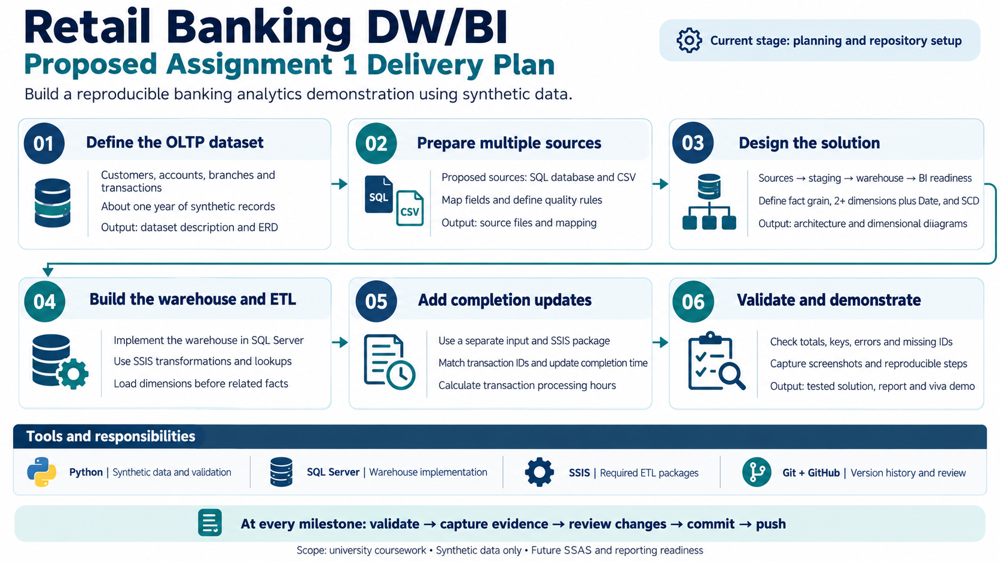

# Retail Banking Analytics Prototype

A self-directed DW/BI demonstration using synthetic retail-banking data. The project follows the technical topics in IT3021 Assignments 1 and 2 through one shared dataset and warehouse.

## Current stage

Project setup and the first small Python example are complete. The data model and pipeline will be developed incrementally and validated at each milestone.

## First Python example

[deposit_example.py](deposit_example.py) represents two fictional deposits as a list of dictionaries and uses a loop and an if condition to print the total for the selected transaction branch. It is an introductory example; it does not connect to a database or generate a dataset.

Run from the project root on Windows with Python 3 installed:

    py -3 .\deposit_example.py

Expected output: 2000 for BR002; the BR001 deposit of 2500 is excluded. The selected branch is set in the loop condition.

## Proposed scope

- Customer, Account, Branch and Transaction entities.
- About one year of meaningful synthetic records.
- SQL and file-based sources feeding a SQL Server warehouse through SSIS.
- Dimension-history handling and a separate transaction-completion update flow.
- SSAS and Excel analysis, followed by interactive Power BI reports.
- Python for source generation and independent validation.

## Project plan

- [Full project proposal (PDF)](docs/retail-banking-analytics-proposal.pdf)
- [Proposal text](docs/retail-banking-analytics-proposal.md)

The plan describes proposed work. Implementation artifacts and reproducible instructions will be added as the project develops.

## Data

Use synthetic demonstration data. Validate relationships, row counts, amounts, dimension history and processing times before relying on analytical results.
