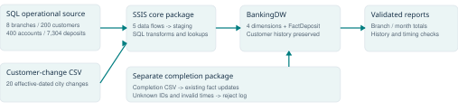
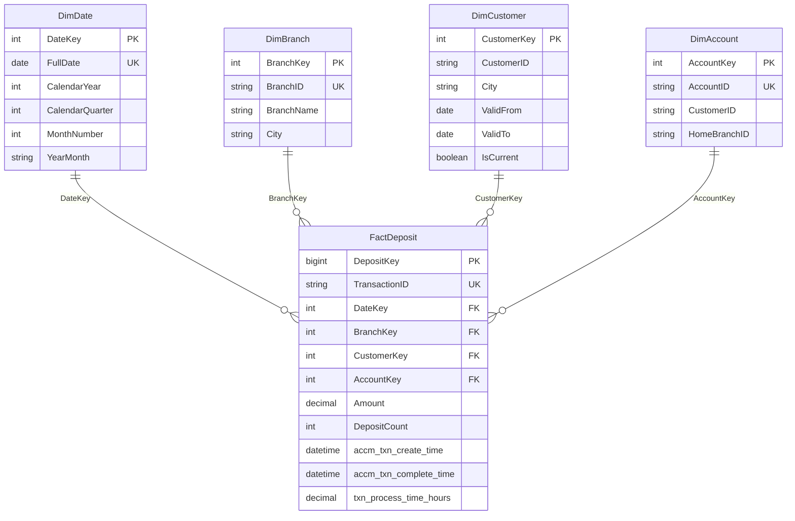

# Retail banking warehouse: technical handover

**Status:** working local warehouse prototype, validated on 26 October 2026. All records and amounts are fictional. The [two-page PDF summary](WAREHOUSE_HANDOVER.pdf) is suitable for a supervisor-facing project discussion.

## What was delivered

- Reproducible Python source generator with seed 3021 and seven automated tests.
- SQL Server operational source: 8 branches, 200 customers, 400 accounts and 7,304 deposits covering all 365 days of 2026.
- Separate `BankingDW` warehouse with four dimensions and one deposit fact table.
- Two real SQL Server 2022 SSIS packages: initial/history/fact loading and separate completion updates.
- Type 2 Customer history, temporal dimension lookups, fact upserts, audit/reject tables, SQL validations and reusable reports.
- One-command reproduction plus automated SSIS integration tests for repeat loads and error inputs.

The warehouse total is **182,891,102.97 synthetic currency units**. All 7,304 facts have completion timestamps. The 20 simulated customer changes produce 220 Customer versions. The deliberate unknown completion ID is logged and does not insert a fact.



## Dimensional model and grain

**Fact grain: one row per deposit transaction.** `TransactionID` is the preserved business identifier; `DepositKey` is the warehouse row identifier. Amount and DepositCount are additive across the dimensions. BranchKey identifies the branch that handled the deposit; DimAccount.HomeBranchID describes the account home branch.



Customer city history uses `[ValidFrom, ValidTo)` intervals: the start is included and the end is excluded. A move creates a new CustomerKey; the previous version remains. The fact lookup uses the deposit date, not simply IsCurrent. C001 demonstrates 32 deposits associated with Piliyandala before 1 July and 41 associated with Maharagama from 1 July onward.

## Source contracts

| Feed | Role and encoding |
|---|---|
| BankingOLTP Branch/Customer/Account/Deposit | Typed operational SQL source; Customer represents the synthetic base snapshot at 1 January 2026 |
| customer_changes.csv | Independent simulated profile-change events: 20 customer IDs, new cities and effective dates; UTF-16 LE CSV with BOM and CRLF |
| completion_updates.csv | Separate completion-event feed generated after initial fact loading; UTF-16 LE CSV with BOM and CRLF; 7,304 matching IDs plus deliberate unknown MISS000001 |

The four original sample deposits remain in the generated year. The generated operational CSVs and SQL tables are alternate representations of those same source records. The profile changes and completion events are distinct inputs; duplicate-format operational copies are not double-counted.

Amounts use one illustrative currency unit, with exact decimal cents. Calendar dates after the build date are synthetic scenario dates. No actual customer identity, institution performance, currency conversion or account-balance model is implied.

## SSIS execution order

`BankingWarehouse.dtsx`:

1. Prepare staging without deleting dimensional/fact history.
2. Extract Branch, Customer, Account and Deposit from SQL Server using four OLE DB data flows.
3. Extract the customer-change CSV using a Unicode Flat File data flow.
4. Execute `etl.LoadWarehouse`: Date and descriptive dimensions, Customer history, temporal dimension lookups, then fact upserts.

`CompletionUpdates.dtsx`:

1. Prepare separate completion staging.
2. Extract the independent Unicode CSV in a Flat File data flow.
3. Execute `etl.ApplyCompletions`: match TransactionID, update existing facts, calculate decimal hours and log rejected rows.

SSIS performs extraction, staging and orchestration. Set-based SQL procedures invoked by Execute SQL tasks perform transformations, lookups, Type 2 changes and fact updates. This is SQL pushdown within a real SSIS workflow; Python does not load the warehouse.

The packages were created through the supported [Microsoft SSIS package SDK](https://learn.microsoft.com/en-us/sql/integration-services/building-packages-programmatically/building-packages-programmatically?view=sql-server-ver16). The [Execute SQL task](https://learn.microsoft.com/en-us/sql/integration-services/control-flow/execute-sql-task?view=sql-server-ver16) runs their stored procedures. `SsisPackageBuilder.cs` and `build_packages.ps1` reproduce the native package files. Package files use relative data paths and Windows Authentication; they contain no passwords or user-specific paths.

## Timestamp interpretation

Initial fact creation uses SQL Server system time, following the brief's numbered load-time requirement. The source event calendar date stays in DimDate. `export_completions.ps1` builds a controlled completion feed from each fact's creation timestamp with a positive delay of 30 to 195 minutes. Completion processing does not overwrite an already matching completion, and a conflicting or earlier time is rejected.

These processing hours demonstrate the accumulating-update mechanism. They are **simulated warehouse-workflow durations**, not measured banking service SLAs. Event dates and warehouse processing timestamps must not be confused.

## Reproduce the whole prototype

Prerequisites already verified for this build: running SQL Server 2022 Developer Database Engine, SQL Server 2022 SSIS runtime, Microsoft OLE DB SQL driver, sqlcmd, Python 3.14 and 64-bit Windows PowerShell. The package SDK uses .NET Framework, so use `powershell.exe`, not `pwsh`.

From the repository root:

```powershell
powershell.exe -NoProfile -ExecutionPolicy Bypass -File .\ssis\run_demo.ps1
```

This regenerates the sources, runs seven source tests, applies safe source/schema scripts, runs both native SSIS packages, checks the warehouse and exports report data. It preserves existing source values on conflict and does not wipe existing facts/history on reruns. The script explicitly uses the SQL Server 2022 runtime instead of an older DTExec that may be first on PATH.

Rebuild native packages after editing their builder:

```powershell
powershell.exe -NoProfile -ExecutionPolicy Bypass -File .\ssis\run_demo.ps1 -RebuildPackages
```

Run the source tests or the full integration tests independently:

```powershell
py -3 -m unittest discover -s tests -v
powershell.exe -NoProfile -ExecutionPolicy Bypass -File .\ssis\test_pipeline.ps1
```

The integration test takes complete fact/history SHA-256 snapshots, reruns both packages, injects an unknown customer and an invalid completion timestamp, checks rejection without changing valid rows, restores the exact input bytes, and reruns the nominal packages.

## Inspect results and explain the work

Open `sql/013_validate_warehouse.sql` in SSMS and execute it against the local server. It asserts source/fact counts, transaction IDs, amounts, dimensional mapping, date coverage, history intervals, completion calculations and the missing-ID policy. `sql/014_warehouse_reports.sql` returns branch/month totals, the C001 history example and run statuses.

Generated report data stays local under `data/generated/`: `warehouse_report.json`, `branch_totals.csv` and `monthly_totals.csv`. Runtime logs and all generated source files also remain ignored.

A concise project explanation is:

> I developed a reproducible synthetic banking warehouse prototype. I used Python to generate and validate the source data, SQL Server to enforce relationships and store a dimensional model, and SSIS to integrate SQL and CSV inputs. I preserved customer history, implemented separate completion updates, and tested reconciliation, safe reruns and rejected inputs. The result can be reproduced with one command and produces branch/month analytical outputs.

This describes the validated synthetic prototype. Production bank deployment remains outside this delivery.

## Validation and operating notes

- Seven automated source tests pass, including decimal precision, foreign references, duplicate IDs, calendar coverage, reproducibility and history inputs.
- Operational SQL rows were reconciled field by field to generated source records.
- Both actual native SSIS packages return success. All 7,304 facts and 182,891,102.97 amount units reconcile.
- Rerunning both packages preserves complete fact rows, surrogate keys, history versions and timestamps.
- Unknown customer history and invalid completion timestamps are rejected without changing valid facts. A missing completion ID is deliberately logged once per completion run.
- Audit/reject tables retain development and test runs, including a corrected CSV-quoting test failure. Inspect the latest run for each package rather than treating all historic rejection counts as the current load.
- The runtime emitted a warning that optional data-flow performance counters were unavailable in the execution session. Package exit codes and all data assertions passed; no system permissions were changed to silence it.
- The package runtime was verified. A Visual Studio SSIS designer extension and a production deployment/scheduler were not verified or configured.

## Remaining scope

The warehouse core and its static analytical demonstration are implemented. SSAS cubes, Excel OLAP operations and the full Power BI/Service behaviors from the second brief remain separate presentation milestones. They are not claimed complete here.

The next lakehouse prototype can reuse the same source contracts, validation cases and business definitions: raw landing, cleaned relational records and analytical outputs. Its storage/compute stack and production/workplace integration have not been implemented. Keep any workplace-specific project separate from this synthetic demonstration repository.
